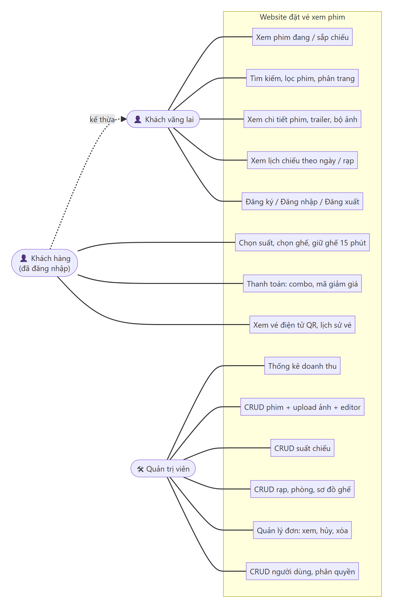
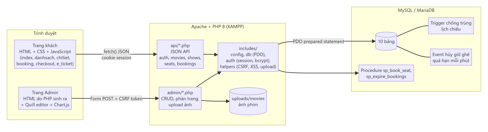
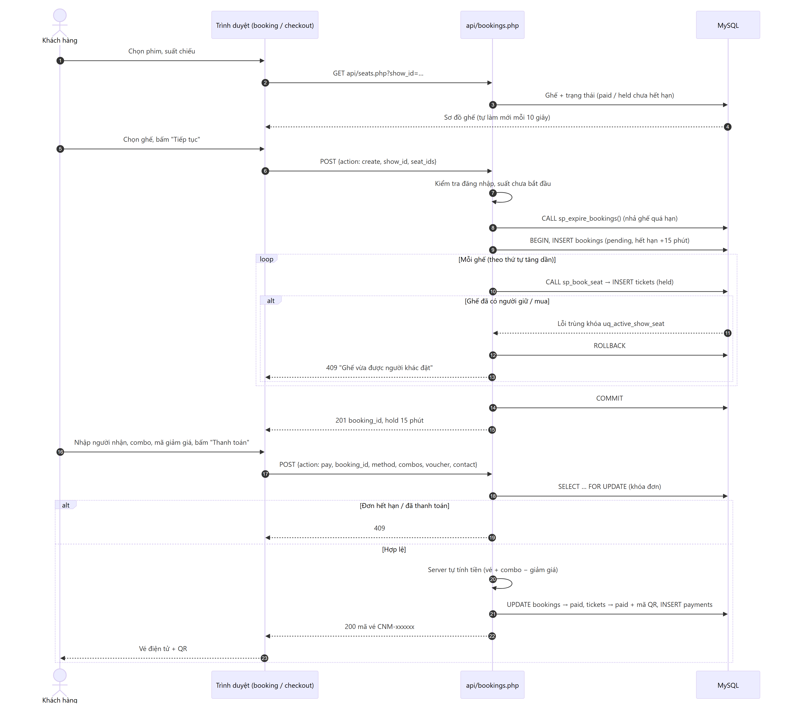
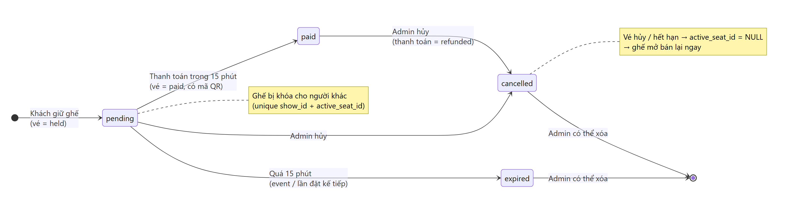
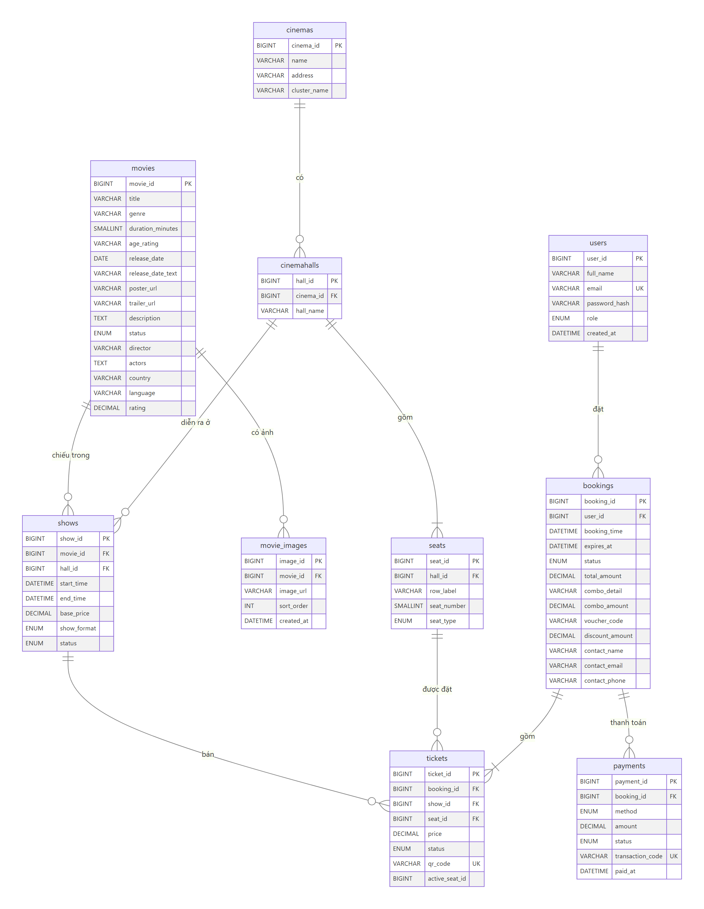

# PHÂN TÍCH THIẾT KẾ HỆ THỐNG
## Website đặt vé xem phim — Cinema Manage System

> Môn: Lập trình Web — Bài tập nhóm cuối kỳ
> Chủ đề: **Website bán hàng cơ bản** (sản phẩm là vé xem phim)
> Công nghệ: PHP 8 + MySQL/MariaDB (backend), HTML/CSS/JavaScript (frontend)

---

## 1. Giới thiệu

### 1.1. Bài toán
Rạp chiếu phim cần một website để:
- Khách hàng xem phim đang chiếu / sắp chiếu, xem lịch chiếu, **chọn ghế và mua vé trực tuyến**, nhận vé điện tử có mã QR.
- Nhân viên quản trị quản lý phim, rạp, phòng chiếu, sơ đồ ghế, suất chiếu, đơn đặt vé, tài khoản và theo dõi doanh thu.

### 1.2. Vì sao là "Website bán hàng"
| Khái niệm bán hàng | Trong hệ thống |
|---|---|
| Danh mục, sản phẩm | Thể loại, phim, suất chiếu |
| Tồn kho | Ghế còn trống của từng suất |
| Giỏ hàng | Ghế đang chọn, **giữ chỗ 15 phút** trên server |
| Thanh toán | Chọn phương thức, combo bắp nước, mã giảm giá |
| Đơn hàng | Đơn đặt vé (`bookings`) gồm nhiều vé (`tickets`) |
| Hóa đơn / biên nhận | Vé điện tử, mã `CNM-xxxxxx`, QR soát vé |
| Quản trị bán hàng | Trang Admin: sản phẩm, đơn hàng, khách hàng, doanh thu |

### 1.3. Đối chiếu yêu cầu đề bài
| Yêu cầu | Đáp ứng |
|---|---|
| PHP + MySQL ở backend | PHP 8 (PDO, session) + MySQL/MariaDB (procedure, trigger, event) |
| Trang người dùng + trang Admin | 6 trang khách; 11 trang Admin (chỉ vai trò `admin`) |
| Giao diện đẹp, hiện đại, responsive | Kiểm tra ở 390 / 768 / 1024 / 1280 / 1440 px, không tràn ngang; bảng Admin tự chuyển dạng thẻ trên điện thoại |
| CRUD đầy đủ | Phim, ảnh phim, suất chiếu, rạp, phòng, ghế, người dùng (thêm–xem–sửa–xóa); đơn vé (xem–hủy–xóa, tạo từ trang khách) |
| Đăng nhập, đăng xuất, phân quyền | Đăng ký/đăng nhập/đăng xuất bằng session; mật khẩu bcrypt; vai trò `customer` / `admin` |
| Phân trang | Mọi danh sách Admin (server-side), danh sách phim trang khách, API `movies.php?page=&limit=` |
| Upload nhiều ảnh | Poster + bộ ảnh nhiều file cho mỗi phim (bảng `movie_images`) |
| Editor | Quill (rich text) cho nội dung phim, HTML được lọc chống XSS ở server |

---

## 2. Tác nhân và chức năng (Use case)



| Tác nhân | Mô tả | Chức năng chính |
|---|---|---|
| Khách vãng lai | Chưa đăng nhập | Xem phim, tìm kiếm, lọc, xem chi tiết, trailer, bộ ảnh, lịch chiếu; đăng ký / đăng nhập |
| Khách hàng | Đã đăng nhập (`customer`) | Tất cả quyền của khách vãng lai + giữ ghế, thanh toán, xem vé điện tử và lịch sử vé |
| Quản trị viên | `admin` | Thống kê; CRUD phim (upload ảnh, editor), suất chiếu, rạp, phòng, ghế, người dùng; quản lý đơn |

### 2.1. Chức năng trang khách
| Trang | Chức năng |
|---|---|
| `index.html` | Banner phim nổi bật, tab Đang chiếu / Sắp chiếu, ô tìm kiếm gợi ý tức thì |
| `danhsach.html` | Lọc theo thể loại, cụm rạp, rạp, ngày chiếu; phân trang; tìm theo từ khóa |
| `chitiet.html` | Thông tin phim, nội dung định dạng, trailer YouTube, bộ ảnh, lịch chiếu theo ngày & rạp |
| `booking.html` | Chọn phim / rạp / ngày / suất, sơ đồ ghế thời gian thực (tự làm mới 10 giây), tối đa 8 ghế |
| `checkout.html` | Thông tin người nhận vé, combo, mã giảm giá, phương thức thanh toán, đồng hồ giữ ghế |
| `e_ticket.html` | Vé điện tử, QR, in vé, lịch sử vé (đọc từ database) |

### 2.2. Chức năng trang Admin (`/admin`)
| Trang | Chức năng |
|---|---|
| Tổng quan | Doanh thu, vé đã bán, phim đang chiếu, suất sắp chiếu, khách hàng, đơn đang giữ ghế; biểu đồ doanh thu 7 ngày; phim bán chạy; đơn mới nhất |
| Phim | CRUD, tìm kiếm, lọc trạng thái, phân trang; upload poster + nhiều ảnh (xem trước, xóa từng ảnh); editor Quill |
| Suất chiếu | CRUD; tự tính giờ kết thúc (thời lượng + 15 phút dọn phòng); chặn trùng giờ trong cùng phòng; trạng thái "Đã chiếu" tự động |
| Rạp chiếu | CRUD, tìm kiếm, phân trang; không xóa rạp còn phòng |
| Phòng & ghế | CRUD phòng, tự sinh sơ đồ ghế (số hàng thường / VIP / ghế đôi); sửa loại ghế, thêm hàng, xóa ghế |
| Đơn đặt vé | Lọc theo trạng thái / ngày / khách; chi tiết vé, bảng tính tiền (vé + combo − giảm giá), thanh toán; hủy đơn (mở lại ghế, hoàn tiền); xóa đơn đã hủy |
| Người dùng | CRUD, phân quyền; không thể tự hạ quyền / tự xóa / xóa admin cuối cùng |

---

## 3. Kiến trúc hệ thống



- **Trang khách**: HTML/CSS/JS tĩnh, gọi **JSON API** (`api/*.php`) bằng `fetch()`; phiên đăng nhập là cookie session PHP.
- **Trang Admin**: trang PHP render phía server, dùng form POST có **CSRF token**.
- **`includes/`**: dùng chung — cấu hình (`.env`), kết nối PDO, xác thực & phân quyền, tiện ích (escape, lọc HTML, upload, phân trang).
- **CSDL**: 10 bảng + 2 stored procedure + 2 trigger + 1 event.

### 3.1. Cấu trúc thư mục
```text
├── index.html, danhsach.html, chitiet.html, booking.html, checkout.html, e_ticket.html
├── css/, js/, assets/        # Giao diện trang khách
├── api/                      # JSON API: auth, movies, cinemas, shows, seats, bookings
├── admin/                    # Trang quản trị PHP (+ assets/: CSS, JS, editor, biểu đồ)
├── includes/                 # config, db, auth, helpers (bị chặn truy cập từ web)
├── uploads/movies/           # Ảnh admin upload (không chạy được file PHP)
├── sql/                      # schema, procedure, trigger, event, dữ liệu mẫu, migration
└── docs/                     # Tài liệu này + sơ đồ (diagrams/*.mmd, *.png)
```

---

## 4. Luồng nghiệp vụ chính: đặt vé



**Các quy tắc nghiệp vụ:**
1. Chỉ bán vé cho suất **còn lịch (`scheduled`) và chưa bắt đầu** — kiểm tra ở giao diện, API và trong procedure `sp_book_seat`.
2. Tối đa **8 ghế** mỗi đơn; ghế phải thuộc đúng phòng của suất chiếu.
3. Bấm "Tiếp tục" là **giữ ghế 15 phút** trên server (đơn `pending`, vé `held`); người khác thấy ghế đã bị giữ.
4. **Chống đặt trùng ghế**: unique key `(show_id, active_seat_id)` trên bảng `tickets` — hai người đặt cùng một ghế cùng lúc, chỉ người đến trước thành công, người sau nhận lỗi 409.
5. **Giá do server tính**: ghế thường = giá gốc suất, VIP = giá gốc + 20.000đ, ghế đôi = 190.000đ; combo Solo 79.000đ, Couple 139.000đ; mã `CINEMA20` (−20.000đ), `UTH2026` (−15%). Trình duyệt chỉ gửi *số lượng* và *mã*, không gửi số tiền.
6. Thanh toán khóa dòng đơn (`SELECT … FOR UPDATE`) để không thanh toán 2 lần và không đua với job hết hạn.

### 4.1. Vòng đời đơn đặt vé



| Trạng thái đơn | Trạng thái vé | Ghế | Ai chuyển |
|---|---|---|---|
| `pending` (đang giữ ghế) | `held` | Bị khóa | Khách bấm "Tiếp tục" |
| `paid` (đã thanh toán) | `paid` + mã QR | Bị khóa | Khách thanh toán trong 15 phút |
| `expired` (hết hạn) | `expired` | Mở bán lại | Event mỗi phút / lần đặt vé kế tiếp |
| `cancelled` (đã hủy) | `cancelled` | Mở bán lại | Admin hủy (thanh toán → `refunded`) |

---

## 5. Thiết kế giao diện
- Bảng màu thống nhất (tím indigo `#4338CA`) giữa trang khách và Admin; font hệ thống.
- **Responsive**: menu Admin thu thành nút ☰ dưới 1100px; bảng dữ liệu chuyển thành thẻ dưới 820px; sơ đồ ghế co giãn đủ 10 ghế/hàng trên điện thoại 360px.
- Phản hồi rõ ràng: thông báo thành công/lỗi (flash), ô nhập lỗi viền đỏ, hộp xác nhận trước khi xóa, trang lỗi 403 có giao diện.

---

## 6. Thiết kế cơ sở dữ liệu

### 6.1. Sơ đồ quan hệ (ERD)



- 10 bảng, chuẩn hóa 3NF; khóa chính `BIGINT AUTO_INCREMENT`; bảng mã `utf8mb4` (tiếng Việt, emoji).
- Toàn vẹn dữ liệu bằng **khóa ngoại**, **CHECK** (giá ≥ 0, giờ kết thúc > giờ bắt đầu, điểm 0–10…), **UNIQUE** (email, tên phòng trong rạp, vị trí ghế, mã QR, mã giao dịch).
- Xóa phim thì xóa luôn ảnh (`ON DELETE CASCADE`); các bảng khác chặn xóa khi còn dữ liệu liên kết (ứng dụng hiển thị thông báo thân thiện).

> Bảng mô tả dưới đây được **sinh tự động từ cấu trúc thật trong MySQL**, nên luôn khớp với `sql/schema.sql`.

### 6.2. Bảng `users`

Tài khoản người dùng (khách hàng và quản trị viên).

| Cột | Kiểu | Null | Khóa | Mô tả |
|---|---|---|---|---|
| `user_id` | bigint(20) | Không | PK | Khóa chính, tự tăng |
| `full_name` | varchar(100) | Không |  | Họ tên |
| `email` | varchar(255) | Không | UNIQUE | Email đăng nhập (duy nhất) |
| `password_hash` | varchar(255) | Không |  | Mật khẩu đã mã hóa bcrypt |
| `role` | enum('customer','admin') | Không |  | Vai trò: customer / admin. Mặc định: customer |
| `created_at` | datetime | Không |  | Ngày tạo tài khoản. Mặc định: current_timestamp() |

- Unique `uq_users_email` (email)

### 6.3. Bảng `movies`

Phim: thông tin hiển thị, trạng thái đang/sắp chiếu.

| Cột | Kiểu | Null | Khóa | Mô tả |
|---|---|---|---|---|
| `movie_id` | bigint(20) | Không | PK | Khóa chính, tự tăng |
| `title` | varchar(255) | Không |  | Tên phim |
| `genre` | varchar(100) | Không |  | Thể loại |
| `duration_minutes` | smallint(5) unsigned | Có |  | Thời lượng (phút) |
| `age_rating` | varchar(10) | Có |  | Phân loại độ tuổi (P, K, T13, T16, T18) |
| `release_date` | date | Có |  | Ngày khởi chiếu |
| `release_date_text` | varchar(100) | Có |  | Ghi chú khởi chiếu (vd: 07/2026) |
| `poster_url` | varchar(500) | Có |  | Đường dẫn ảnh poster |
| `trailer_url` | varchar(500) | Có |  | Link trailer YouTube |
| `description` | text | Có |  | Nội dung phim (HTML từ editor, đã lọc XSS) |
| `status` | enum('coming_soon','now_showing','ended') | Không |  | coming_soon / now_showing / ended. Mặc định: coming_soon |
| `director` | varchar(255) | Có |  | Đạo diễn |
| `actors` | text | Có |  | Diễn viên |
| `country` | varchar(100) | Có |  | Quốc gia |
| `language` | varchar(100) | Có |  | Ngôn ngữ |
| `rating` | decimal(3,1) | Có |  | Điểm đánh giá 0–10 |

- Ràng buộc `chk_movie_duration`: `duration_minutes is null or duration_minutes > 0`
- Ràng buộc `chk_movie_rating`: `rating is null or rating between 0 and 10`
- Index `idx_movies_status` (status)

### 6.4. Bảng `movie_images`

Bộ ảnh của phim (chức năng upload nhiều ảnh).

| Cột | Kiểu | Null | Khóa | Mô tả |
|---|---|---|---|---|
| `image_id` | bigint(20) | Không | PK | Khóa chính, tự tăng |
| `movie_id` | bigint(20) | Không | FK → movies.movie_id | Tham chiếu movies.movie_id |
| `image_url` | varchar(500) | Không |  | Đường dẫn ảnh |
| `sort_order` | int(11) | Không |  | Thứ tự hiển thị. Mặc định: 0 |
| `created_at` | datetime | Không |  | Thời điểm upload. Mặc định: current_timestamp() |

- Index `idx_movie_images_movie` (movie_id,sort_order)

### 6.5. Bảng `cinemas`

Rạp chiếu, nhóm theo cụm rạp.

| Cột | Kiểu | Null | Khóa | Mô tả |
|---|---|---|---|---|
| `cinema_id` | bigint(20) | Không | PK | Khóa chính, tự tăng |
| `name` | varchar(150) | Không |  | Tên rạp |
| `address` | varchar(255) | Không |  | Địa chỉ |
| `cluster_name` | varchar(100) | Có |  | Cụm rạp |

### 6.6. Bảng `cinemahalls`

Phòng chiếu thuộc một rạp.

| Cột | Kiểu | Null | Khóa | Mô tả |
|---|---|---|---|---|
| `hall_id` | bigint(20) | Không | PK | Khóa chính, tự tăng |
| `cinema_id` | bigint(20) | Không | FK → cinemas.cinema_id | Tham chiếu cinemas.cinema_id |
| `hall_name` | varchar(100) | Không |  | Tên phòng (duy nhất trong 1 rạp) |

- Unique `uq_hall_name_per_cinema` (cinema_id,hall_name)

### 6.7. Bảng `seats`

Ghế ngồi trong phòng chiếu (thường / VIP / đôi).

| Cột | Kiểu | Null | Khóa | Mô tả |
|---|---|---|---|---|
| `seat_id` | bigint(20) | Không | PK | Khóa chính, tự tăng |
| `hall_id` | bigint(20) | Không | FK → cinemahalls.hall_id | Tham chiếu cinemahalls.hall_id |
| `row_label` | varchar(5) | Không |  | Hàng ghế (A, B, …) |
| `seat_number` | smallint(5) unsigned | Không |  | Số ghế trong hàng |
| `seat_type` | enum('standard','vip','couple') | Không |  | standard / vip / couple. Mặc định: standard |

- Ràng buộc `chk_seat_number`: `seat_number > 0`
- Unique `uq_seat_hall` (seat_id,hall_id)
- Unique `uq_seat_position` (hall_id,row_label,seat_number)

### 6.8. Bảng `shows`

Suất chiếu: phim nào, phòng nào, thời gian, giá gốc.

| Cột | Kiểu | Null | Khóa | Mô tả |
|---|---|---|---|---|
| `show_id` | bigint(20) | Không | PK | Khóa chính, tự tăng |
| `movie_id` | bigint(20) | Không | FK → movies.movie_id | Tham chiếu movies.movie_id |
| `hall_id` | bigint(20) | Không | FK → cinemahalls.hall_id | Tham chiếu cinemahalls.hall_id |
| `start_time` | datetime | Không |  | Giờ bắt đầu |
| `end_time` | datetime | Không |  | Giờ kết thúc (> giờ bắt đầu) |
| `base_price` | decimal(12,2) | Không |  | Giá vé ghế thường |
| `show_format` | enum('2d_sub','2d_dubbed') | Không |  | 2d_sub (phụ đề) / 2d_dubbed (lồng tiếng). Mặc định: 2d_sub |
| `status` | enum('scheduled','cancelled','finished') | Không |  | scheduled / cancelled / finished. Mặc định: scheduled |

- Ràng buộc `chk_show_times`: `end_time > start_time`
- Ràng buộc `chk_show_price`: `base_price >= 0`
- Index `idx_shows_hall_time` (hall_id,start_time)
- Index `idx_shows_movie_time` (movie_id,start_time)
- Index `idx_shows_start_time` (start_time)
- Unique `uq_show_hall` (show_id,hall_id)

### 6.9. Bảng `bookings`

Đơn đặt vé (tương đương đơn hàng): giữ ghế → thanh toán.

| Cột | Kiểu | Null | Khóa | Mô tả |
|---|---|---|---|---|
| `booking_id` | bigint(20) | Không | PK | Khóa chính, tự tăng |
| `user_id` | bigint(20) | Không | FK → users.user_id | Tham chiếu users.user_id |
| `booking_time` | datetime | Không |  | Thời điểm đặt. Mặc định: current_timestamp() |
| `expires_at` | datetime | Có |  | Hạn giữ ghế (15 phút) |
| `status` | enum('pending','paid','cancelled','expired') | Không |  | pending / paid / cancelled / expired. Mặc định: pending |
| `total_amount` | decimal(12,2) | Không |  | Số tiền khách trả (vé + combo − giảm giá). Mặc định: 0.00 |
| `combo_detail` | varchar(255) | Có |  | Mô tả combo đã mua |
| `combo_amount` | decimal(12,2) | Không |  | Tiền combo. Mặc định: 0.00 |
| `voucher_code` | varchar(30) | Có |  | Mã giảm giá đã dùng |
| `discount_amount` | decimal(12,2) | Không |  | Số tiền được giảm. Mặc định: 0.00 |
| `contact_name` | varchar(100) | Có |  | Tên người nhận vé |
| `contact_email` | varchar(255) | Có |  | Email người nhận vé |
| `contact_phone` | varchar(15) | Có |  | SĐT người nhận vé |

- Ràng buộc `chk_booking_total`: `total_amount >= 0`
- Index `idx_bookings_status_expires` (status,expires_at)
- Index `idx_bookings_user` (user_id)

### 6.10. Bảng `tickets`

Vé: mỗi ghế của một suất trong một đơn.

| Cột | Kiểu | Null | Khóa | Mô tả |
|---|---|---|---|---|
| `ticket_id` | bigint(20) | Không | PK | Khóa chính, tự tăng |
| `booking_id` | bigint(20) | Không | FK → bookings.booking_id | Tham chiếu bookings.booking_id |
| `show_id` | bigint(20) | Không | FK → shows.show_id | Tham chiếu shows.show_id |
| `seat_id` | bigint(20) | Không | FK → seats.seat_id | Tham chiếu seats.seat_id |
| `price` | decimal(12,2) | Không |  | Giá vé tại thời điểm đặt |
| `status` | enum('held','paid','cancelled','expired') | Không |  | held / paid / cancelled / expired. Mặc định: held |
| `qr_code` | varchar(255) | Có | UNIQUE | Mã QR soát vé (duy nhất) |
| `active_seat_id` | bigint(20) | Có |  | Cột tự sinh: = seat_id khi vé còn hiệu lực, NULL khi hủy/hết hạn → chống đặt trùng ghế |

- Ràng buộc `chk_ticket_price`: `price >= 0`
- Index `idx_tickets_booking` (booking_id)
- Index `idx_tickets_seat` (seat_id)
- Index `idx_tickets_show_seat_status` (show_id,seat_id,status)
- Unique `uq_active_show_seat` (show_id,active_seat_id)
- Unique `uq_tickets_qr_code` (qr_code)

### 6.11. Bảng `payments`

Giao dịch thanh toán của đơn đặt vé.

| Cột | Kiểu | Null | Khóa | Mô tả |
|---|---|---|---|---|
| `payment_id` | bigint(20) | Không | PK | Khóa chính, tự tăng |
| `booking_id` | bigint(20) | Không | FK → bookings.booking_id | Tham chiếu bookings.booking_id |
| `method` | enum('cash','bank_transfer','card','ewallet') | Không |  | cash / bank_transfer / card / ewallet |
| `amount` | decimal(12,2) | Không |  | Số tiền thanh toán |
| `status` | enum('pending','success','failed','refunded') | Không |  | pending / success / failed / refunded. Mặc định: pending |
| `transaction_code` | varchar(100) | Có | UNIQUE | Mã giao dịch (duy nhất) |
| `paid_at` | datetime | Có |  | Thời điểm thanh toán |

- Ràng buộc `chk_payment_amount`: `amount >= 0`
- Index `idx_payments_booking` (booking_id)
- Unique `uq_payments_transaction_code` (transaction_code)

### 6.12. Stored procedure, trigger, event
| Đối tượng | Loại | Tác dụng |
|---|---|---|
| `sp_book_seat(booking, show, seat, price)` | Procedure | Kiểm tra suất còn lịch & chưa bắt đầu, ghế thuộc đúng phòng, tính giá theo loại ghế, thêm vé `held` |
| `sp_expire_bookings()` | Procedure | Chuyển đơn `pending` quá hạn và vé `held` sang `expired` (nhả ghế) |
| `trg_shows_no_overlap_insert` | Trigger | Chặn thêm suất trùng giờ trong cùng phòng |
| `trg_shows_no_overlap_update` | Trigger | Chặn sửa suất thành trùng giờ trong cùng phòng |
| `ev_expire_bookings` | Event | Gọi `sp_expire_bookings()` mỗi phút (API cũng gọi trước mỗi lần đặt vé, phòng khi event tắt) |

---

## 7. Bảo mật
| Rủi ro | Biện pháp |
|---|---|
| SQL injection | 100% truy vấn dùng PDO prepared statement |
| XSS | Escape mọi dữ liệu khi in HTML (`htmlspecialchars` / `textContent`); HTML từ editor lọc theo danh sách thẻ cho phép (bỏ `<script>`, `onerror`, `javascript:`…) |
| Lộ mật khẩu | `password_hash` (bcrypt), không lưu mật khẩu ở trình duyệt |
| Chiếm phiên | Cookie `HttpOnly` + `SameSite=Lax`; đổi session ID khi đăng nhập |
| CSRF | Form Admin có CSRF token; API chỉ nhận `Content-Type: application/json` |
| Leo thang quyền | Mọi trang Admin kiểm tra vai trò từ database mỗi request (hạ quyền có hiệu lực ngay) |
| Upload độc hại | Kiểm tra định dạng thật bằng `finfo` + `getimagesize`, đổi tên ngẫu nhiên, giới hạn 5 MB; `uploads/` không chạy được PHP |
| Gian lận giá | Server tự tính tiền; bỏ qua mọi số tiền trình duyệt gửi lên |
| Open redirect | Chỉ chuyển hướng sau đăng nhập về trang nội bộ `/admin/` |
| Lộ cấu hình | `.htaccess` chặn `.env`, `includes/`, `sql/` |

---

## 8. Danh sách API (trang khách)
| Phương thức | Đường dẫn | Đăng nhập | Mô tả |
|---|---|---|---|
| GET | `api/movies.php[?id=&page=&limit=]` | | Danh sách / chi tiết phim (kèm bộ ảnh) |
| GET | `api/cinemas.php` | | Danh sách rạp |
| GET | `api/shows.php[?movie_id=]` | | Suất chiếu, trạng thái thực tế, `bookable` |
| GET | `api/seats.php?show_id=` | | Sơ đồ ghế, giá, ghế trống / đã đặt |
| GET | `api/auth.php?action=me` | | Người đang đăng nhập |
| POST | `api/auth.php?action=register` · `login` · `logout` | | Tài khoản |
| GET | `api/bookings.php` | ✔ | Lịch sử đặt vé của tôi |
| POST | `api/bookings.php` `{action:"create", show_id, seat_ids}` | ✔ | Giữ ghế 15 phút |
| POST | `api/bookings.php` `{action:"pay", booking_id, method, combos, voucher, contact}` | ✔ | Thanh toán |

Mọi phản hồi có dạng `{ success, message, data }`; lỗi trả mã HTTP phù hợp (400, 401, 403, 404, 409, 415, 500).

---

## 9. Kiểm thử
Kiểm thử tự động bằng trình duyệt thật (Chrome) và gọi API trực tiếp:

| Bộ kiểm thử | Số ca | Nội dung |
|---|---|---|
| Trang khách & API | 36 | Đăng nhập đúng/sai, đặt vé khi chưa đăng nhập, **2 tài khoản tranh cùng 1 ghế**, thanh toán 2 lần, thanh toán đơn người khác, quyền truy cập Admin, chặn truy cập `.env` / `includes/` |
| Trang Admin (CRUD) | 55 | Thêm/sửa/xóa phim kèm upload ảnh, chặn file PHP giả ảnh, lọc XSS editor, phân trang, tìm kiếm; rạp, phòng (tự sinh ghế), sơ đồ ghế; suất chiếu (tự tính giờ, chặn trùng giờ); hủy/xóa đơn; tạo user, phân quyền, chặn tự hạ quyền; CSRF; open redirect |
| Giao diện | — | Đo tràn ngang & chụp màn hình ở 390 / 768 / 1024 / 1280 / 1440 px cho mọi trang |
| Tính tiền | 6 | Combo + mã giảm cố định / phần trăm, mã giả, số lượng âm, gửi số tiền giả |

Kết quả: **tất cả đều đạt**.

---

## 10. Cài đặt
Xem `README.md`: cài XAMPP (PHP ≥ 8.1), chép dự án vào `htdocs`, chạy các file trong `sql/` theo thứ tự, cấu hình `.env` (cổng, mật khẩu MySQL), mở `http://localhost/<thư-mục>/`.

Tài khoản mẫu: `admin@cinema.local` / `admin123` (quản trị), `customer@cinema.local` / `123456` (khách hàng).

---

## Phụ lục: sửa sơ đồ
Mọi sơ đồ nằm trong `docs/diagrams/` dưới dạng **Mermaid** (`*.mmd`, văn bản thường). Muốn sửa: mở https://mermaid.live, dán nội dung file `.mmd`, chỉnh rồi tải lại ảnh PNG.
